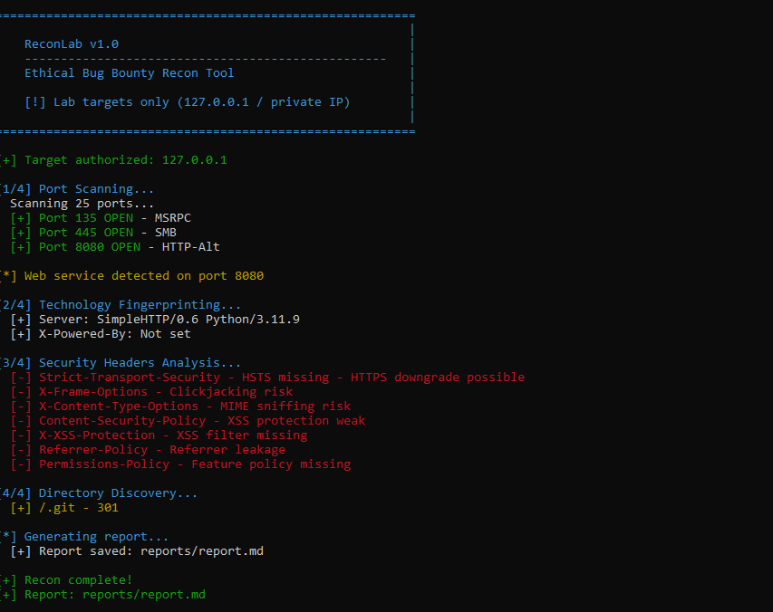
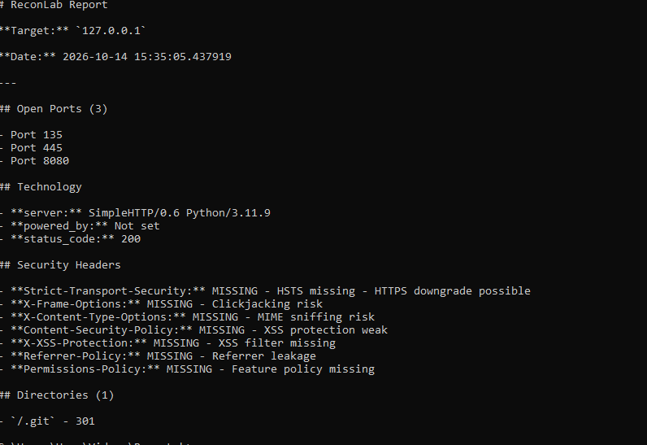

# 🔍 ReconLab

**Ethical Bug Bounty Reconnaissance Tool** — An authorized-only recon tool for your own lab.


## ⚠️ Legal Disclaimer

**For EDUCATIONAL and AUTHORIZED TESTING purposes ONLY.**

- ✅ Only works on private IPs (127.x, 10.x, 192.168.x, 172.16-31.x)
- ❌ NEVER use on public IPs or unauthorized targets
- ❌ Unauthorized access is a CRIMINAL offense

The tool has **built-in authorization guard** — it will refuse any public target.

## ✨ Features

- 🔍 **Port Scanner** — Parallel TCP port scanning
- 🛠️ **Tech Fingerprint** — Server, framework detection
- 🔒 **Header Analyzer** — Missing security headers
- 📁 **Directory Discovery** — Common path discovery
- 📄 **Report Generator** — Markdown reports
- 🛡️ **Authorization Guard** — Private IPs only

## 📸 Screenshots

### Full Recon Scan

*Complete reconnaissance scan — port scanning, tech fingerprinting, security header analysis, and directory discovery.*

### Generated Report

*Auto-generated markdown report with all findings.*

## 🚀 Installation

### Requirements

- Python 3.11+
- Windows / Linux

### Steps

```bash
# Clone
git clone https://github.com/rakesh722150-png/ReconLab.git
cd ReconLab

# Virtual environment
py -3.11 -m venv venv
venv\Scripts\activate.bat

# Install
pip install -r requirements.txt
```

## 🎮 Usage

### Basic scan (common ports)

```bash
python reconlab.py 127.0.0.1
```

### Specific port

```bash
python reconlab.py 127.0.0.1 --ports 8080
```

### Port range

```bash
python reconlab.py 127.0.0.1 --ports 1-1024
```

### Custom report

```bash
python reconlab.py 127.0.0.1 -r reports/my_scan.md
```

### Skip directories

```bash
python reconlab.py 127.0.0.1 --skip-dirs
```

## 📊 Sample Output

```
==========================================================
|   ReconLab v1.0                                        |
|   Ethical Bug Bounty Recon Tool                        |
==========================================================

[+] Target authorized: 127.0.0.1

[1/4] Port Scanning...
  [+] Port 135 OPEN - MSRPC
  [+] Port 445 OPEN - SMB
  [+] Port 8080 OPEN - HTTP-Alt

[*] Web service detected on port 8080

[2/4] Technology Fingerprinting...
  [+] Server: SimpleHTTP/0.6 Python/3.11.9

[3/4] Security Headers Analysis...
  [-] Strict-Transport-Security - HSTS missing
  [-] X-Frame-Options - Clickjacking risk

[4/4] Directory Discovery...
  [+] /.git - 301

[+] Recon complete!
[+] Report: reports/report.md
```

## 🏗️ Architecture

```
ReconLab/
├── reconlab.py              # Main CLI
├── modules/
│   ├── port_scanner.py      # Port scan
│   ├── tech_fingerprint.py  # Tech detect
│   ├── header_analyzer.py   # Security headers
│   ├── dir_discovery.py     # Directory discovery
│   └── report.py            # Report generator
├── reports/                 # Generated reports
└── wordlists/               # Custom wordlists
```

## 🎯 Use Cases

- Practice on **DVWA** (Damn Vulnerable Web App)
- Test on **OWASP Juice Shop**
- Scan **your own VMs**
- Learn Bug Bounty methodology

## 🚧 Roadmap

- [x] Port scanning
- [x] Tech fingerprint
- [x] Header analysis
- [x] Directory discovery
- [x] Report generator
- [ ] Subdomain enumeration
- [ ] CVE lookup
- [ ] JSON output

## 👤 Author

**Rakesh**
- GitHub: [@rakesh722150-png](https://github.com/rakesh722150-png)

## 📄 License

MIT License

---

⭐ **Star this repo if you found it useful!**